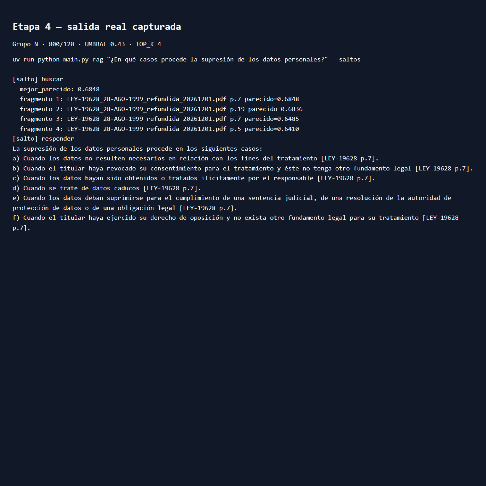
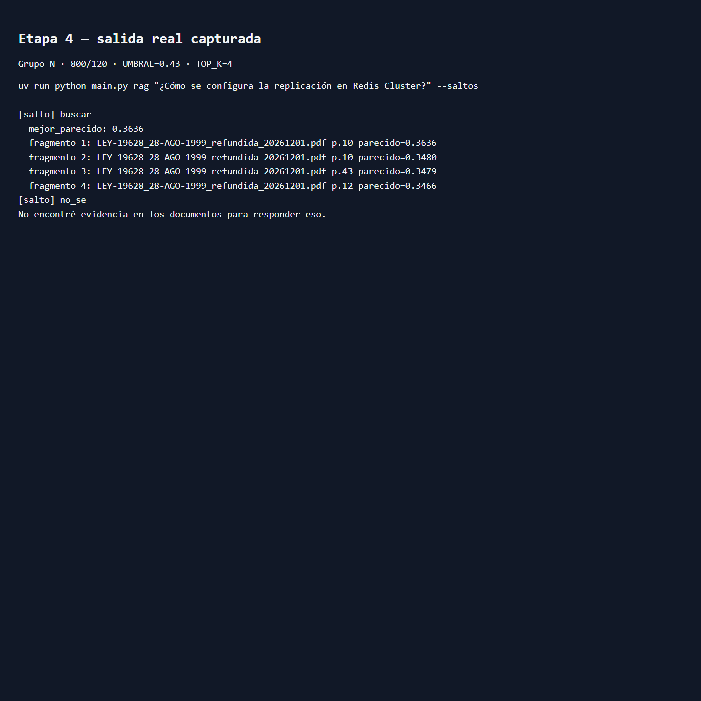
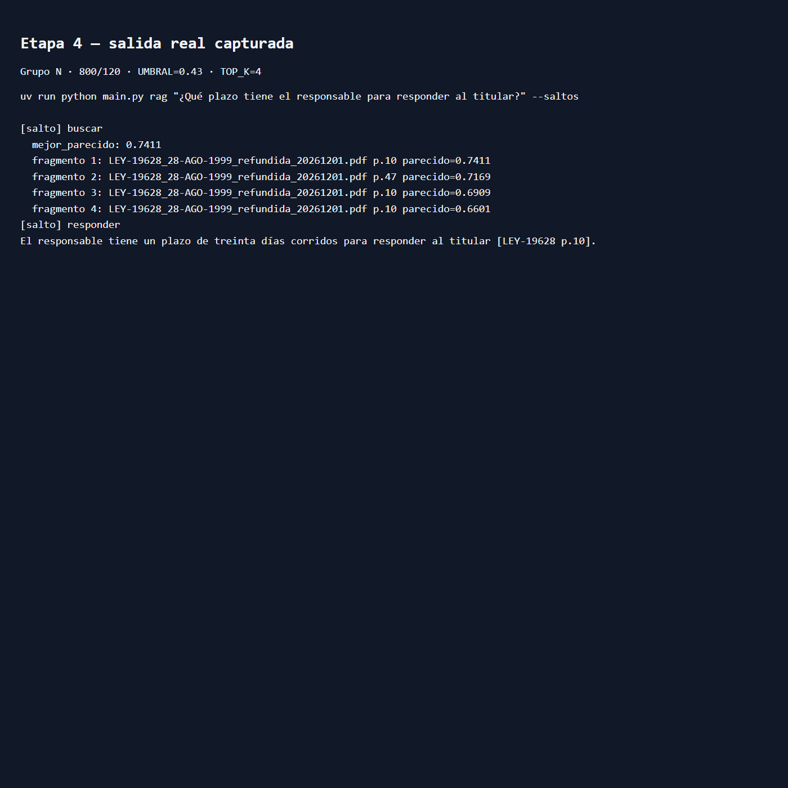

<!--
Integrantes: Fabio Durán; Gustavo Reyes; Ezequiel Muñoz
Objetivo: fuente compilable del documento de entrega del taller RAG, con identificación, estado y evidencias.
fecha_hora_creacion: 20261028_1958
fecha_hora_modificacion: 20261028_2001
-->

# Taller 2 — Agente RAG

## Documento de entrega

**Grupo: N**

**Integrantes:** Fabio Durán; Gustavo Reyes; Ezequiel Muñoz.

**Declaración:** no se utilizó material de compañeros.

**Fecha:** 28 de octubre de 2026.

### Alcance y estado de la evidencia

Este documento compila el código, los prompts, las pruebas y las limitaciones
registradas para el agente RAG. No se presentan como exitosas pruebas cuyo
resultado fue parcial o negativo. La auditoría registró que la captura/respuesta
específica de construcción de etapa 1 todavía figura pendiente en
`pruebas/construccion.md`; por tanto, esta compilación no oculta ese faltante.

**Configuración medida:** Redis persistente, Ollama `qwen3:8b`, embeddings
`bge-m3`, `CHUNK_SIZE=800`, `CHUNK_OVERLAP=120`, `TOP_K=4` y `UMBRAL=0.43`.
La copia en `proyecto/` aún está incompleta: contiene `docs/`, `scripts/`,
`src/` y `tests/`, pero los archivos raíz de proyecto están en la carpeta
superior y falta `proyecto/README.md`. También se detectó un `.env` en la carpeta
de entrega; no se leyó ni se incluyó en este DOCX, y debe excluirse del ZIP.
Los secretos e índices locales tampoco forman parte de este documento.

La plantilla pedida para la sección de prompts está en
`pruebas/prompts.md`: incluye los seis prompts principales de OpenCode con sus
fuentes y correcciones, además de `SYSTEM_PROMPT`, `USER_PROMPT` y
`PROMPT_REFORMULAR` finales. Esta copia deja explícitos los límites encontrados
en las pruebas de las etapas 5 y 6.

\newpage

# Evidencias visuales seleccionadas

Las capturas siguientes presentan salidas reales de `--saltos` para las tres
clases de consulta de la batería. Son imágenes de una vista de salida guardada;
los archivos TXT/HTML de origen están en `pruebas/capturas/`.

\newpage

# Desarrollo y evidencias

Los apartados siguientes compilan el plan de entrega, la rúbrica y los
resultados detallados de cada etapa. Las instrucciones originales y los
registros de sesión se mantienen en `instrucciones/` y `salidas_opencode/`;
las salidas crudas están referenciadas desde `pruebas/capturas/`.
